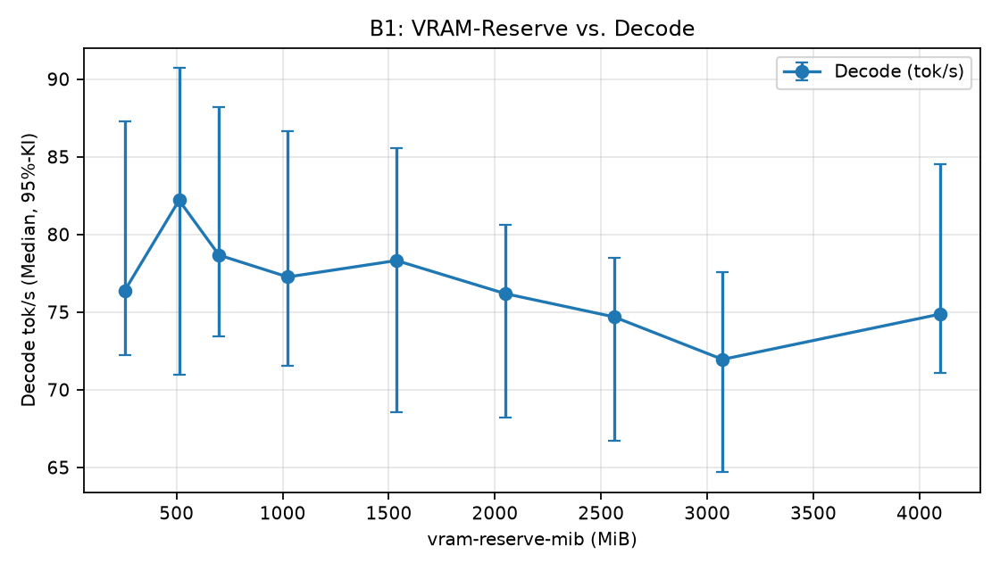
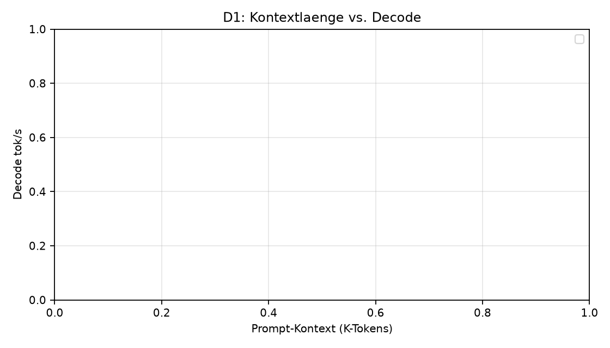
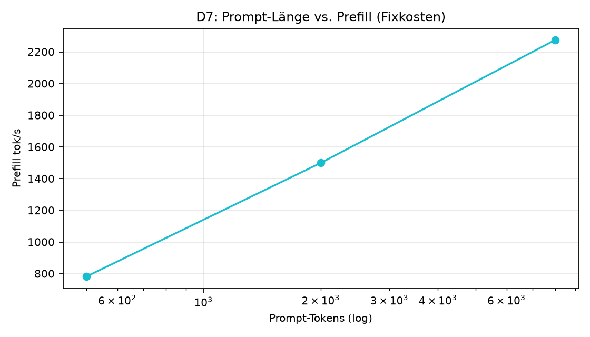

# Strata-HotRod Benchmark — RTX 3090 24 GB / 96 GB DDR4 / Windows 10

Reproduzierbare Benchmark-Reihe (120 Läufe) für **Strata-HotRod**
(`sangharshadhyeta/Strata-HotRod`, Commit `ac1ade5f`, Engine 0.1.45) mit
**Qwen3.8-Flash-Next IQ3_S** (ISTA-DASLab GSQ-RCO, ~78 GB) — inklusive
Live-Telemetrie aus dem HotRod-Monitor.

> **Deutsche Kurzfassung:** 120 Läufe, feste gehash-te Prompts, n=8 (n=5 bei
> Langkontext), Warm-up verworfen, Bootstrap-95-%-KIs und Mann-Whitney.
> Wichtigster Befund: `--vram-reserve-mib 0` blockiert den ersten Request nach
> dem Modell-Load (~74 s), 512 MiB nicht. Die empfohlene Config ändert genau
> diesen einen Wert. Die aktive Config des Systems wurde nicht überschrieben.

## Hardware

| Komponente | Wert |
|---|---|
| GPU | NVIDIA GeForce RTX 3090 24 GB, Treiber 591.74, WDDM, PCIe 4.0 x16 (unter Last Gen4) |
| CPU | AMD Ryzen 7 5800X (8C/16T) |
| RAM | 96 GB DDR4-2933 (3×32 GB) |
| OS | Windows 10 Pro 19045 |
| Storage | Patriot P300 NVMe (DRAM-less) |

## Die fünf wichtigsten Ergebnisse

1. **VRAM-Reserve ist der einzige klare Hebel.** Mit 0 MiB brauchte der erste
   Request nach dem Load **73,6 s** (WDDM-Overcommit / „0 MiB free"), mit
   512 MiB nur **2,2 s**. Im Sweep hatte 512 MiB den höchsten Decode-Median
   (**82,2 tok/s**; 700 MiB 78,7; 3072 MiB 72,0) — statistisch **nicht
   signifikant** (p=0,22), aber konsistent mit dem Stall-Befund.
2. **Prefill-Chunk wirkt bei langen Prompts.** 32K-Prompts: `auto:32768`
   **2.539 tok/s** / TTFT 11,8 s gegenüber `auto:4096` 1.782 tok/s / 16,8 s.
   Bei 128K ist das Bild gemischter (1.665–2.197 tok/s).
3. **Kontext kostet Decode.** 4K/16K ≈ 87–93 tok/s, 64K 71 tok/s,
   128K/200K ≈ 52–54 tok/s. Prefill bleibt bei ~1.700–2.450 tok/s.
4. **Engpass ist GPU + CPU-Experten, nicht die SSD.** Decode-Timeline:
   ~53 % „GPU alone/host waiting", ~45 % CPU-Experten, **0 %** Demand-Reads
   und 0 % Wartezeit auf laufende Reads. 90-Min-Dauerlauf: 2.905 Requests,
   0 Fehler, RAM konstant 69,6 %, Speed 86 → 80 tok/s (leichte Drift).
5. **Telemetrie kostet nichts Messbares.** Recorder an/aus: 82,3 vs. 77,8 tok/s;
   Record an/aus: 80,7 vs. 78,6 tok/s — beide nicht signifikant. Needle-Recall
   bei 32K und 128K: **9/9 gefunden**.

Standardprotokoll (`strata bench run`): Chat 62,4 tok/s, 4K-Prefill 1.877 tok/s,
16K-Prefill 2.396 tok/s, Agenten-Session 71,5 tok/s, Cache-Hit-Rate 69,6 %.






Interaktive Übersicht: [`dashboard/index.html`](dashboard/index.html)

## Empfohlene Alltags-Config

[`configs/recommended-strata-iq3_s.json`](configs/recommended-strata-iq3_s.json)
– nur `--vram-reserve-mib 512` statt 0. Diff und Einordnung:
[`docs/RECOMMENDED_DIFF.md`](docs/RECOMMENDED_DIFF.md). Die aktive Config
wurde **nicht** überschrieben.

**Belegt / Tendenz / kein Effekt**

- *Belegt:* Reserve 0 → Stall; Needle-Recall; fehlende SSD-Nutzung; kein
  Telemetrie-Overhead; MTP ist zwingend ( natives Pack braucht `--spec ≥ 2`).
- *Tendenz:* 512 MiB etwas schneller als 700/2048/3072; 32K-Chunk 32768 schneller
  als 4096; leichte Abnahme über 90 Min.
- *Kein messbarer Effekt:* alle F1-Einzelschalter, F2-Varianten, RAM-Limits,
  Experten-Anzahl ↔ Decode (r=0,03, p=0,76).

## Methodik

- Feste, gehash-te Prompts: [`prompts/prompts.json`](prompts/prompts.json), 15 Stück
- n=8 (P1/P2), n=5 (P3+); Warm-up nach jedem Engine-Start verworfen und geloggt
- Decode tok/s **nur** aus `predicted_n/predicted_ms` (Engine-Timings)
- Median, IQR, Bootstrap-95-%-KI (Seed 20261123), Mann-Whitney p<0,05
- Varianten innerhalb der Blöcke randomisiert; A2 misst Drift (66,6→74,7→73,7 tok/s)
- Telemetrie: `GET /metrics` 1 Hz, Record via `POST /v1/monitor/timeline`
  ([TELEMETRY.md](TELEMETRY.md)); Speed-Läufe ohne Record, Timeline extra (n=3)

## Grenzen und übersprungene Tests

Eine GPU, ein Quant, ein Modell. Power-Limit nicht änderbar (kein Admin) →
H1 (200/250/300/350 W) als „nicht automatisierbar" dokumentiert; H2/Defender
ebenfalls ohne Admin. `F2_mtp_off` und `I2_parity_mtp_off` sind **nicht möglich**:
das native IQ-Pack verlangt `--spec ≥ 2`. `K4_vision_off` startete nicht.
`G3_defender` scheiterte an fehlenden Rechten. Manuell: HAGS, Kaltstart, XMP,
CUDA Sysmem Fallback Policy.

## Reproduktion

```powershell
uv venv .venv --python 3.11
uv pip install --python .venv/Scripts/python.exe numpy pandas matplotlib scipy psutil pynvml pyyaml requests plotly
python runner/make_prompts.py
python runner/make_matrix.py
python runner/bench.py --matrix runner/matrix.yaml
python runner/analyze.py
python runner/charts.py
python runner/dashboard.py
python runner/timeline_analysis.py
```

Pfade in `runner/bench.py` müssen an die lokale Installation angepasst werden
(bei der Veröffentlichung geschwärzt). Siehe [FLAGS.md](FLAGS.md) für alle
verifizierten Schalter.

## Lizenz

MIT — siehe `LICENSE`.
